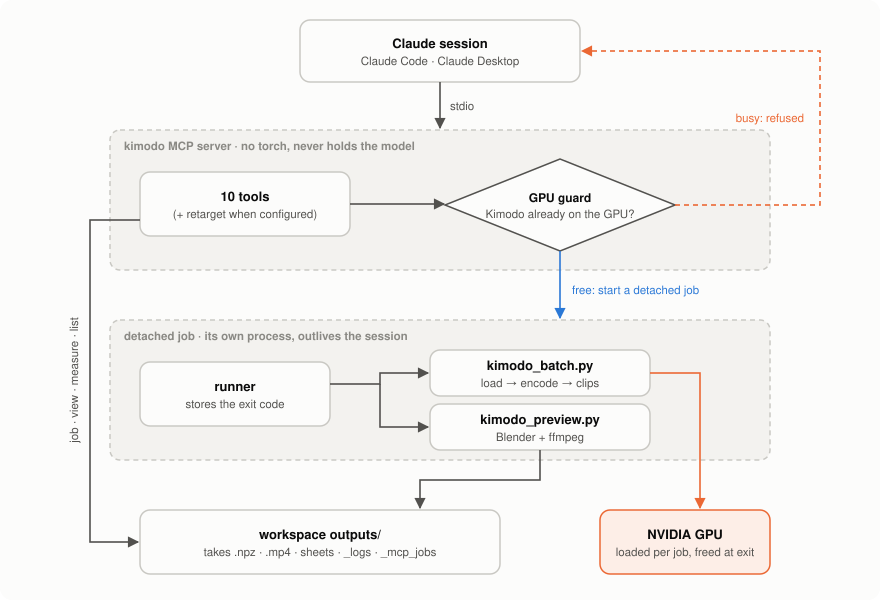
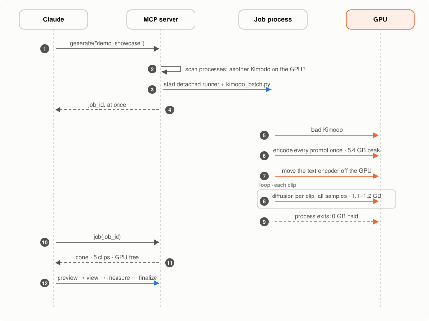
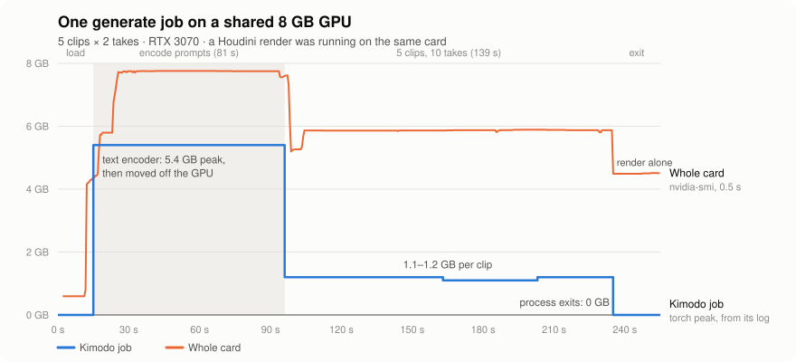
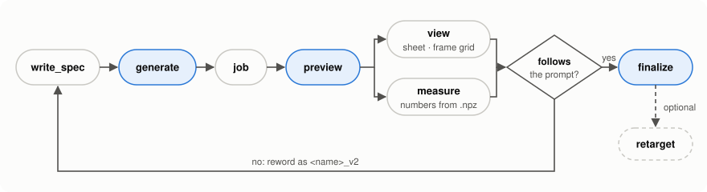
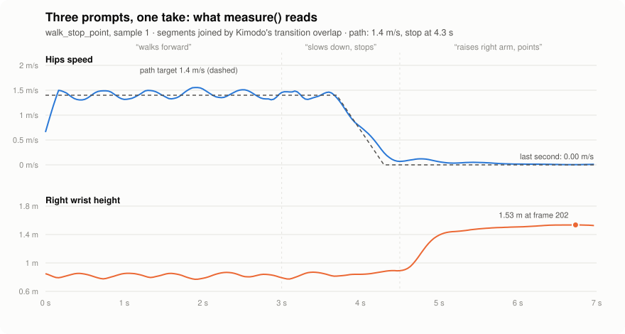

<div align="center">

# kimodo-mcp

**Text-to-motion as tools for Claude.** A standalone MCP server that plugs into your existing
[NVIDIA Kimodo](https://github.com/nv-tlabs/kimodo) install: it writes motion specs, generates takes as background
jobs, renders previews, looks at them, measures them and collects the picks, without ever holding the model on your
GPU between jobs.

[](LICENSE)


<sub>Four takes from <a href="examples/demo_showcase.json"><code>examples/demo_showcase.json</code></a>, generated, previewed and picked through the tools below. Rendered on Kimodo's own SOMA body.</sub>

</div>

---

## What it does

You talk to Claude; Claude drives Kimodo.

> *"Make me a 7-second take: a person walks at 1.4 m/s, slows down and points ahead with the right arm. Two samples, then show me the frames and tell me which one stops cleaner."*

Claude writes the spec, starts the job, follows its progress, renders the previews, looks at frame grids, reads the
numbers from the motion file and hands you the better take, with frame numbers for what is wrong in the other one.

| | |
|---|---|
| **GPU-friendly by design** | The server never imports torch. Each job loads Kimodo in its own process; when the job ends, the process exits and the GPU is free again for Blender, renders or anything else. |
| **Safe on a shared card** | A generation is refused while another Kimodo process (a CLI batch, the web demo, another session) is on the GPU. Low free VRAM gives a warning. |
| **Jobs outlive the chat** | Jobs are detached. Close the session and the batch keeps going; any session can read any job's state and log. |
| **Claude can see the motion** | `view` returns contact sheets and frame grids with frame numbers as images; `measure` turns the take's joints into numbers (speed, lean, which hand rises, foot slide, airborne spans). |
| **Works with your Kimodo** | No fork, no bundled install: point it at the Python of the Kimodo you already have. The engine scripts ship inside the package and also run by hand. |

## Tools

| tool | what it does | runs as |
|---|---|---|
| `status` | GPU memory, Kimodo processes on the GPU, other GPU apps (Blender, Houdini, Cascadeur), running jobs; `install_check` tests your Kimodo env (doctor) | instant |
| `write_spec` | validates a spec (keys, seconds, files, prompt form) and writes `specs/<name>.json`; refuses to reuse a name with other prompts | instant |
| `generate` | runs the batch engine on a spec: one model load, all prompts encoded once, every clip and sample; resumes, `only`, `force`, `samples`, `reexport` | **background job** |
| `job` | state and progress of any job (phase, clips done, error lines, GPU after); also reads a CLI run's log | instant |
| `cancel` | stops a job this server started, with its whole process tree; nothing else is ever touched | instant |
| `preview` | Blender renders each take on the SOMA body to mp4, a contact sheet per clip, README | **background job** |
| `list_outputs` | output folders, or one batch's clips with prompts, notes, constraint residuals and which files exist | instant |
| `view` | a clip's contact sheet, or a frame grid of one take with frame numbers, **as an image** | instant |
| `measure` | numbers from a take's `.npz`: travel, speed per second, body turn, trunk lean, hands, feet, step-up height, slide, airborne spans | instant |
| `finalize` | writes `picks.json` and collects the chosen takes (`.npz`, `.mp4`, `.fbx`) into one folder with a README | instant |
| `retarget` | *(only when configured)* runs your retarget script on a picks folder as a job and reads its report | **background job** |

## How it works

<picture>
  <source media="(prefers-color-scheme: dark)" srcset="docs/architecture_dark.svg">
  
</picture>

A job is a record in `outputs/_logs/_mcp_jobs/<id>.json` plus a log in `outputs/_logs/`. The runner that starts the
script waits for it and writes the exit code, so the state is right even when the session that started the job is gone.

<picture>
  <source media="(prefers-color-scheme: dark)" srcset="docs/sequence_dark.svg">
  
</picture>

### What the GPU sees

<picture>
  <source media="(prefers-color-scheme: dark)" srcset="docs/vram_dark.svg">
  
</picture>

Measured on the demo batch (5 clips × 2 takes) while a Houdini render shared the card. The blue line is Kimodo's own
torch peak per phase, as the batch logs it; the orange line is the whole card from `nvidia-smi`. With the card full,
the 5.4 GB encode spilled into shared memory and took 81 s (about 15 s on a free card); after it, Kimodo stays near
1.2 GB and lets the render have the rest. When the job ends, nothing of Kimodo is left on the GPU.

## The workflow

<picture>
  <source media="(prefers-color-scheme: dark)" srcset="docs/workflow_dark.svg">
  
</picture>

### A spec

```json
{
  "name": "demo_showcase",
  "seed": 2026,
  "samples": 2,
  "clips": [
    {"name": "walk_steady", "prompt": "A person walks forward at a steady, relaxed pace.", "seconds": 5,
     "path": {"speed": 1.4}},
    {"name": "wave_right", "prompt": "A person stands still and waves their right hand above their head.", "seconds": 4},
    {"name": "walk_stop_point", "segments": [
        {"prompt": "A person walks forward at a steady, relaxed pace.", "seconds": 3},
        {"prompt": "A person walking forward slows down and comes to a stop.", "seconds": 1.5},
        {"prompt": "A person standing still raises their right arm and points forward.", "seconds": 2.5}],
     "path": {"speed": 1.4, "stop_at": 4.3}}
  ]
}
```

| key (per clip) | what it does |
|---|---|
| `prompt`, `seconds` | one prompt, up to 10 s |
| `segments` | several prompts as **one continuous take**, joined by Kimodo's own transition overlap (`transition`, frames) |
| `path` | where the root travels, so speed is a number and not a prompt word: `{"speed": 1.4}`, `{"speed": 1.4, "stop_at": 4.3}` or `{"points": [[sec, x, z], ...]}` |
| `poses` | a pose taken from another take at a time, optionally mirrored or for one limb only |
| `hands` | a wrist target in space at a time |
| `ground` | fits the finished take to sloping land: `{"rise": 0.12}` or a height profile |
| `constraints` | a Kimodo constraints file as saved by the demo, passed through |
| `seed`, `samples`, `in_place`, `diffusion_steps` | per clip overrides |

Same spec + same seed gives the same motion. Full key reference: the docstrings of
[`kimodo_batch.py`](src/kimodo_mcp/scripts/kimodo_batch.py) and [`kimodo_author.py`](src/kimodo_mcp/scripts/kimodo_author.py).

### What `view` shows Claude


<sub>A contact sheet: one row of six frames per sample. `view(batch, clip, sample=k)` gives a denser grid of one take with frame numbers.</sub>

### What `measure` reads

<picture>
  <source media="(prefers-color-scheme: dark)" srcset="docs/measure_dark.svg">
  
</picture>

The `walk_stop_point` take above, read from its `.npz`: the hips hold the 1.4 m/s path, come to rest at the stop
(0.00 m/s in the last second), and the right wrist rises to 1.53 m for the point. `measure` returns these as JSON,
for example:

```json
"hips":  {"travel_m": 5.81, "speed_first_s_ms": 1.42, "speed_last_s_ms": 0.0, ...},
"hands": {"right": {"rise_max_m": 0.69, "max_frame": 202, "max_height_m": 1.53, "frames_above_head": 0, ...},
          "rises": "right"},
"feet":  {"left": {"lift_max_m": 0.12, "standing_height_max_m": 0.03, "planted_pct": 68, "slide_cm": 10.7, ...}, ...},
"airborne": []
```

Distances are metres at human scale (Y up, +Z ahead, +X to the character's left). In a front view the character's
right is on the image's left; `measure` settles sides from the data.

## Install

**You need**

- A working **Kimodo** install with its Python environment: [nv-tlabs/kimodo](https://github.com/nv-tlabs/kimodo)
  (on an 8 GB card, [Aero-Ex/kimodo](https://github.com/Aero-Ex/kimodo) with its NF4 text encoder is the lighter
  option). kimodo-mcp only needs that environment's `python`.
- An NVIDIA GPU, [Blender](https://www.blender.org/) 4.x/5.x and `ffmpeg` on `PATH` for previews,
  and [uv](https://docs.astral.sh/uv/).

**Register it with Claude Code** (all projects), pointing at your Kimodo Python and a workspace folder for specs and
outputs:

```bash
claude mcp add -s user kimodo \
  -e KIMODO_PYTHON="C:/path/to/kimodo/.venv/Scripts/python.exe" \
  -e KIMODO_ROOT="C:/kimodo-workspace" \
  -- uvx --from git+https://github.com/alivnal/kimodo-mcp kimodo-mcp
```

**Claude Desktop** (`claude_desktop_config.json`):

```json
{
  "mcpServers": {
    "kimodo": {
      "command": "uvx",
      "args": ["--from", "git+https://github.com/alivnal/kimodo-mcp", "kimodo-mcp"],
      "env": {
        "KIMODO_PYTHON": "C:/path/to/kimodo/.venv/Scripts/python.exe",
        "KIMODO_ROOT": "C:/kimodo-workspace"
      }
    }
  }
}
```

Then ask Claude for *"kimodo status with the install check"*: the doctor checks that your Kimodo imports, torch sees
CUDA, the SOMA body asset is there, and whether the optional FBX export, Blender and ffmpeg are found.

The server itself runs in its own small environment (FastMCP, numpy, psutil, Pillow); nothing is installed into your
Kimodo environment.

### FBX export (optional)

Takes are always written as `.npz` (Kimodo's full output for the SOMA skeleton, with the skeleton itself, so it can be
retargeted without Kimodo) and previewed as `.mp4`. A Mixamo FBX per take is added when your Kimodo has a
`kimodo.exports.mixamo_retarget` module (for example the export from
[ComfyUI-Kimodo-Enhanced](https://github.com/stevelittlefish/ComfyUI-Kimodo-Enhanced)), the FBX SDK
(`pip install fbxsdkpy`) and a target character: Mixamo's **Y Bot** saved as
`<workspace>/assets/characters/Y Bot.fbx`, or any Mixamo-rigged FBX named in a spec's `target_fbx`.

### Configuration

Environment variables of the server:

| variable | default | |
|---|---|---|
| `KIMODO_PYTHON` | `<workspace>/venv311` | **the Python of your Kimodo environment** |
| `KIMODO_ROOT` | `~/kimodo-workspace` | the workspace: `specs/`, `outputs/`, `assets/` |
| `BLENDER` | `C:\Program Files\Blender Foundation\Blender 5.2\blender.exe` | Blender for previews |
| `KIMODO_SKIN` | the asset inside the kimodo package | the SOMA body `.npz` the previews draw |
| `KIMODO_RETARGET_SCRIPT` | unset | a bash script that puts takes on your rigged character; enables the `retarget` tool |
| `KIMODO_RETARGET_CWD` | the script folder's parent | where the retarget script runs and writes `anim/<run>/report.md` |
| `GIT_BASH` | `C:\Program Files\Git\bin\bash.exe` | bash for the retarget script on Windows |

The retarget script is called as `<script> <mesh> <run> [clip ...]` with `CLIPS_DIR`, `RIG_FROM`, `JOBS`, `FAST`,
`BASELINE` and `TUBE_ARMS` in its environment, and is expected to write `anim/<run>/report.md`. That is the interface
of a SkinTokens retarget pipeline this server was built with; any script with the same shape works.

## Without Claude

The engine is plain scripts in [`src/kimodo_mcp/scripts/`](src/kimodo_mcp/scripts), run with your Kimodo Python;
the workspace comes from `KIMODO_ROOT`:

```bat
set KIMODO_ROOT=C:\kimodo-workspace
<kimodo python> -u kimodo_batch.py C:\kimodo-workspace\specs\demo_showcase.json
<kimodo python> kimodo_preview.py C:\kimodo-workspace\outputs\demo_showcase
<kimodo python> kimodo_finalize.py C:\kimodo-workspace\outputs\my_picks\picks.json
<kimodo python> kimodo_doctor.py
```

## Numbers

Measured on an RTX 3070 (8 GB), Windows 11, 16 Nov 2026:

| | |
|---|---|
| model load | 1–3 min per job |
| prompt encoding | 11–15 s on a free card, 5.4 GB peak, once per job (81 s with a render sharing the card) |
| one clip, 2 samples | 18–41 s at 1.1–1.2 GB |
| preview | about 25 s per 5 s take (Blender Workbench) |
| path speed | asked 1.2 / 1.6 / 2.0 m/s, got 1.20 / 1.60 / 2.00 m/s |
| hand targets | 0.0 cm from target after Kimodo's post-processing |

## Writing prompts Kimodo follows

- One person, present tense, starting *"A person …"*.
- Describe the body, not the story: *"raises their right arm and points forward"*, not *"points at the summit"*.
- Name the side for one-arm actions; say *"standing still"* when the character must not travel.
- One action per prompt; a sequence goes in `segments`.
- Repetition words work: *"jumps up and down several times"*.
- Speed is a `path`, not an adjective.
- There are no props: anything stepped onto is mid-air.

## Status

Tested end to end on Windows 11 with an RTX 3070, against a Kimodo built on Aero-Ex/kimodo with NVIDIA's v1.2 sync:
every tool was run for real, from an empty workspace as well (FBX export off: `.npz` and previews only). The server's
process handling has Linux code paths (no `creationflags`, a new session per job, `venv311/bin/python` as the default),
but Linux is untested.

## Credits

- [NVIDIA Kimodo](https://github.com/nv-tlabs/kimodo) (Apache-2.0; model weights under the
  [NVIDIA Open Model License](https://www.nvidia.com/en-us/agreements/enterprise-software/nvidia-open-model-license/)),
  with the SOMA body used in the previews.
- [Aero-Ex/kimodo](https://github.com/Aero-Ex/kimodo) and its NF4 text encoder
  [Aero-Ex/KIMODO-Meta3_llm2vec_NF4](https://huggingface.co/Aero-Ex/KIMODO-Meta3_llm2vec_NF4) (its own licence, from
  its base model), which make Kimodo fit an 8 GB card.
- [FastMCP](https://gofastmcp.com) for the server.

Kimodo, its weights, the text encoder and Mixamo characters are not part of this repository; they come from their
sources under their own terms.

## License

MIT © 2026 [Ali Unal](https://github.com/alivnal)
